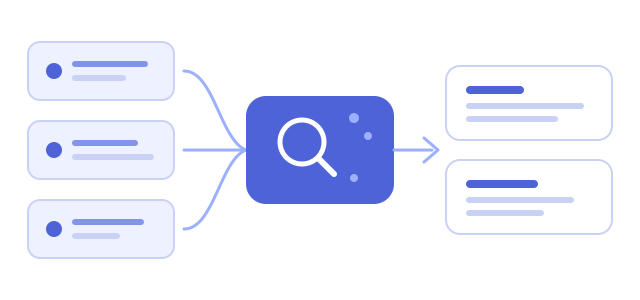

# @qikairo7/dsh-web-search

[](https://github.com/qikairo7/dsh-web-search/releases) [](LICENSE) [](package.json)

English | [中文](README.zh.md)

Self-contained multi-backend web search and fetch providers for DeepSeek Harness (DSH). The bundle replaces the paid official web providers while keeping the first-party `dsh-tool-web` tool layer. The model still calls `web_search` and `web_fetch`; only the backends change, with optional AnySearch / Tavily / AIHOT advanced tools.

Non-goals: the paid DeepSeek Search/Fetch APIs, an MCP server, and third-party DSH plugins.

> Status: pre-1.0. Behavior, defaults, and provider support can change between minor versions. Review [SAFETY.md](SAFETY.md) before use.



## Why this exists

The legacy `deepseek-official` search runs a full model turn for every search. The DeepSeek Search and Fetch APIs charge per successful request. This bundle uses free-tier backends and direct HTTP where possible:

| Backend | Free allowance | Used by |
|---|---|---|
| Keenable | 100,000/month (key); 1,000/hour anonymous | Default search + Markdown fetch |
| AnySearch | 1000 searches/day with a registered key; anonymous access also works | Search |
| Exa | $10 free credits/month (docs.exa.ai); one-time $10 onboarding bonus | Semantic search + Contents fetch; free depth |
| Bing | Keyless HTML SERP; no metered quota | Keyless search floor before the paid tail |
| Zhihu | 5000 global + 5000 site searches/day | Chinese search |
| Tavily | 1000 credits/month | Fallback only: empty free search, missing official docs, stale news, fetch failure chain |
| Firecrawl | 1000 credits/month | Last-resort fetch for hard JS/PDF pages |
| AIHOT | Anonymous read-only | AI-news search/curation (free) |
| Direct HTTP | No API cost | Static-page fetch |
| SiliconFlow | Free allowance | BGE rerank + embeddings |

`quality` mode queries free sources by default (Chinese: Zhihu + Keenable + AnySearch; English: Keenable + AnySearch; AI news adds AIHOT first). Exa's monthly free allowance makes it the free depth hop after the default free stack; Bing adds the keyless floor before the paid tail; Tavily and Firecrawl spend credits only on empty results, missing official docs, stale news, or fetch failures. Evidence enrichment prefers Keenable/HTTP/AnySearch, then Exa/Tavily/Firecrawl. `fast` uses the free order first.

**Why this over the alternatives:**

- Over the DeepSeek Search API: free, not per-request billing, measurably better retrieval on [FRAMES](docs/benchmarks/2026-11-16-role-matrix-redesign.md) (n = 50, 2026-11-16: evidence recall 0.60 vs 0.06, answer hit 0.50 vs 0.40). The trade is latency (~4 s vs 0.4 s), invisible inside async agent turns.
- Over wiring one backend directly (AnySearch, Keenable, and friends ship their own DSH plugins): one backend is one quota and one point of failure. This bundle pools nine free and keyless allowances behind automatic failover, then merges, dedupes, reranks (BGE), and enriches results — the model calls one tool.
- The costs, stated plainly: slower than a raw paid API, and community-maintained rather than a vendor SLA.

## Requirements

- DeepSeek Harness `0.2.2-rc.3` (the version this bundle was verified against).
- Node.js `22.19+` or `24+`.
- A profile that mounts `dsh-web`; the bundle patch enables the first-party `dsh-tool-web` row.

## Install

From a checkout:

```sh
git clone https://github.com/qikairo7/dsh-web-search.git
cd dsh-web-search
dsh plugin --profile desktop add "."
```

Or install the release tarball:

```sh
dsh plugin --profile desktop add path/to/dsh-web-search-<version>.tgz
```

Or install the checkout directory with the Plugin Manager. Restart DSH after installing.

After install, open **Settings → Search and fetch settings**, or **Plugins → Installed plugins → Web search router → Configuration**, to fill provider API keys, enable or disable backends, and set search and fetch modes. Keys are written to the DSH credential store and never read back into the page.

Use **Test** on a provider card to send one real search request and confirm the saved key works. The settings page shows documented free allowances; Tavily and Firecrawl return live remaining values; SiliconFlow balance stays in its console. Keenable reports `credits_remaining` per search/fetch, so **Refresh quota** runs one minimal search to read the latest value. **Pull models** loads the SiliconFlow rerank and embedding model lists. Releases attach installable tarballs; the package is not published to npm.

## Credentials

The plugin reads API keys through the DSH credentials service. Put them in `~/.dsh/.credentials.yaml` (or export them in the launching environment):

```yaml
ANYSEARCH_API_KEY: "as_..."
KEENABLE_API_KEY: "keen_..."
EXA_API_KEY: "..."
TAVILY_API_KEY: "tvly-..."
FIRECRAWL_API_KEY: "fc-..."
ZHIHU_API_KEY: "..."
SILICONFLOW_API_KEY: "sk-..."
```

AnySearch works without a key in anonymous mode; a registered key raises the daily quota. Keenable works anonymously too; a key raises the quota. Exa requires a key. Zhihu requires an Access Secret from the Zhihu Open Platform. Tavily and Firecrawl report themselves not ready when their key is missing, so the router skips them. The exact reference names are configurable with the `*ApiKeyEnv` fields.

For multiple keys, use **Add key** in the provider card to add one row per key. Existing keys show a masked value with a **Delete** button. The plugin stores rows as the base reference plus `_2`, `_3`, … and tries them in order; a key that returns quota, rate-limit, or authentication errors moves to the next key before the router falls back to another provider. Zhihu exposes its daily allowance at `GET /api/v1/quota`; the settings page shows it alongside the other quota rows.

## Providers

| Provider id | Search | Fetch | Default role |
|---|---|---|---|
| `anysearch` | yes | yes | English/default search supplement; broad coverage |
| `keenable` | yes | yes | Free-quota first; search + clean Markdown fetch |
| `exa` | yes | yes | Semantic search + Contents fetch; free depth after the default free stack |
| `bing` | yes | no | Keyless HTML SERP floor before the paid tail |
| `tavily` | yes | yes | Search fallback; news-freshness and official-docs supplements; optional generated answer; PDF Extract |
| `firecrawl` | yes | yes | Fetch last-resort only; strong Scrape for SPA/PDF |
| `zhihu` | yes | no | Chinese search first; global search + site supplement |
| `zhihu-site` | yes | no | Zhihu site-only search when selected explicitly |
| `aihot` | yes | no | Curated AI news for AI-news queries; anonymous |
| `http` | no | yes | Direct HTTP fetch; second after Keenable in the fast order |
| `auto` | yes | yes | Default router for both capabilities |

Default orders:

- Chinese query (at least one Han character): `zhihu → keenable → anysearch → exa → bing → tavily → firecrawl`
- Other query: `keenable → anysearch → exa → bing → tavily → firecrawl`
- Fetch: `keenable → http → anysearch → exa → tavily → firecrawl`

The bundle patch pins the default `auto` provider; individual providers are also registered and selectable in the settings page.

`searchMode` defaults to **quality** (see [Quality pipeline](#quality-pipeline)); Exa holds the free depth position and is not in the default quality fan-out; Bing is the keyless floor; Tavily and Firecrawl are fallback-only. `fetchMode` defaults to **fast**; `clean` uses `keenable → anysearch → exa → http → tavily → firecrawl`, preferring free extraction and keeping Tavily/Firecrawl as fallback. The `tool-web` summary cap comes from the agent preset (standard 800; bundle patches cannot override it — see [the cookbook](docs/cookbook/raising-summary-cap.md)); provider `maxSnippetChars` is 4000 but `web_search` truncates to that cap. Tavily search uses `include_raw_content`; the optional `tavily_search` tool supports `include_published_date`.

### Advanced tools

| Tool | Purpose |
|---|---|
| `anysearch_capabilities` | Discover current AnySearch domains, vertical tags, and parameter definitions |
| `anysearch_search` | Run a vertical or structured search with `tag` / `params` / `zone` |
| `anysearch_batch_search` | Run one to five independent searches concurrently |
| `tavily_search` | Tavily advanced search with depth/topic/time-range/domain filters and optional answer |
| `tavily_extract` | Batch-extract one to twenty URLs through Tavily |
| `aihot_latest` | AIHOT today/week curated AI news, anonymous and free |
| `aihot_hot` | AIHOT current hot topics, anonymous and free |

`anysearchMaxRenderedContentChars` caps the result content `anysearch_search` / `anysearch_batch_search` render to the model per call; default 12000 characters.

## Behavior

### Routing

- **Chinese detection**: any Han script character in the query selects the Chinese order.
- **Zhihu supplement**: for a Chinese query, `zhihu` calls `global_search` first. If it returns fewer than `maxResults` sources, it calls `zhihu_search` and merges the results by URL. English queries do not call the site endpoint.
- **Intent routing**: local rules classify a query as `technical`, `news`, `chinese-community`, or `general`, then choose the provider set and fast-mode order.
- **Language routing**: the project covers Chinese and English only. A query with Han characters is `zh`, otherwise `en`; the value is passed to Tavily/AnySearch as the `language` hint. An explicit `lang:` wins.
- **News mode**: `news` intent enables Tavily `topic: news` + `time_range: week`, Firecrawl news sources + `qdr:w`, the Zhihu realtime index, and AIHOT for AI-news queries. Known Chinese/English news domains get a small ranking bonus; wrong-language news sources are filtered out; AIHOT items get an extra provider boost. Non-AI news queries whose free results carry fewer than 3 sources dated within 7 days trigger one extra Tavily news search (`newsFreshnessEnabled`, default on).
- **Query syntax**: `site:`, `lang:`, `after:`, and `before:` are parsed and forwarded to Tavily, Firecrawl, and Zhihu where their APIs support the filter.

### Quality pipeline

- **Quality search**: `searchMode: quality` queries the language's free providers in parallel (Chinese: Zhihu + Keenable + AnySearch; English: Keenable + AnySearch; AI news: AIHOT + the language set), merges by URL, removes near-duplicates with `BAAI/bge-m3` embeddings, then reranks with `BAAI/bge-reranker-v2-m3` and adds a domain-authority prior (official docs, MDN, GitHub, StackOverflow first). AnySearch page bodies are compressed into an 800–1500 character query-aware extract. If the reranker or embedding service is unavailable, the merged provider order is returned.
- **Live weather/FX**: queries classified as weather or currency-rate use Open-Meteo (weather) or ExchangeRate-API/Frankfurter (FX) first and return one dated source with live values; if those APIs fail, normal search takes over. No key needed.
- **Evidence enrichment**: the top 5 sources are fetched through the default fetch path and their summaries are regenerated at 800–1500 characters. Technical and official-doc pages prefer API signatures, parameters, examples, and code blocks.
- **Official docs supplement**: for technical queries with known official domains (`deepseek-harness.github.io`, `api-docs.deepseek.com`, `nodejs.org`, `developer.mozilla.org`, `react.dev`, `docs.python.org`, `go.dev`, `rust-lang.org`, plus known vendor domains for Docker, Kubernetes, AWS, Azure, GitHub, TypeScript, Java, and NVIDIA), quality mode runs one extra Tavily search restricted to those domains only when free results miss every official domain, drops archived Node.js `/download/release/` docs and old release blogs, and merges the results.
- **Tavily answer**: when `tavilyIncludeAnswer` is on (default), Tavily's generated answer becomes the optional `web_search` `content`. Turn it off to return sources only.
- **Zhihu metadata**: when `zhihuIncludeMetadata` is on (default), each summary starts with `作者：…；赞同 …；评论 …`, giving the model a quality signal inside the provider-neutral source shape.

### Fetch and fallback

- **Direct HTTP**: anonymous; up to 5 redirects (cross-origin allowed), 5 MB response cap, HTML/text/JSON/XML only. PDFs and other binary content throw `WEB_UNSUPPORTED_CONTENT_TYPE` so the router falls back to an API provider. Small client-rendered app shells are detected by `minDirectHtmlChars` (default 2048) and also trigger a fallback.
- **Fallback**: failures are classified as quota, auth, bot-wall, transient, invalid-response, or unknown; `fallbackFailureClasses` (default: all six) decides which classes may try the next provider, and an explicit empty list stops at the first failure. Caller cancellation and invalid URLs return immediately. A 404 from direct HTTP is returned as a result, not a fallback trigger.
- **Clean fetch**: `fetchMode: clean` changes the order to `keenable → anysearch → exa → http → tavily → firecrawl`, preferring free extraction and keeping Tavily/Firecrawl as fallback.
- **Content cleaning**: API fetch providers strip common navigation, sign-in, footer, breadcrumb, repository-navigation, and avatar lines from Markdown before returning it.
- **No private-network blocking**: direct HTTP can reach loopback and private-network hosts, matching the shipped `dsh-web-fetch-http` behavior.

### Cache and circuit breaker

Search results are cached for 5 minutes (200 entries); fetch results for 10 minutes (100 entries). A provider with 3 consecutive recoverable failures is skipped for 5 minutes.

- **Overall deadline**: one search (realtime answer, quality pipeline, or fast fallback) is capped at 3 × `requestTimeoutMs`, so a hanging stage cannot outlive the tool deadline.

## Configuration

See [Configuration](docs/configuration.md) for every field, default, and meaning.

## Development

```sh
pnpm install
git config core.hooksPath .githooks
pnpm docs:check
pnpm check
pnpm probe
pnpm benchmark
```

`pnpm check` runs the guardrail tests and the docs check; the pre-commit hook runs the same command. `pnpm probe` is the daily live probe: 14 fixed queries plus 2 fetches with per-provider telemetry, list-health signals, a rolling 7-day aggregate, and PASS/FAIL verdicts (see [Testing policy](docs/testing.md)). `pnpm benchmark` loads the committed FRAMES/WebWalkerQA fixture first, then falls back to the public rows API; `SAMPLE_SIZE` sets the rows per benchmark (default 50). Run `pnpm benchmark:refresh` when the benchmark data changes. Live API verification requires the credentials above.

## Community and support

- Report bugs and request features in [GitHub Issues](https://github.com/qikairo7/dsh-web-search/issues).
- Read [CONTRIBUTING.md](CONTRIBUTING.md) before you open a pull request.
- Follow the [CODE_OF_CONDUCT.md](CODE_OF_CONDUCT.md) in all community spaces.
- Report vulnerabilities privately as described in [SECURITY.md](SECURITY.md).

## Documentation

- [Architecture](docs/architecture.md)
- [Development guide](docs/development.md)
- [Testing policy](docs/testing.md)
- [Adding a provider](docs/cookbook/adding-a-provider.md)
- [Architecture decisions](docs/adr/)
- [Documentation standard](docs/AGENTS.md)
- [Contributing](CONTRIBUTING.md)
- [Changelog](CHANGELOG.md)
- [Benchmark policy](BENCHMARK.md)
- [Benchmark reports](docs/benchmarks/)
- [Project terms](GLOSSARY.md)

## License

MIT. Third-party code, dependencies, and benchmark data are disclosed in [THIRD_PARTY_NOTICES.md](THIRD_PARTY_NOTICES.md). Names and compatibility statements are covered by [TRADEMARKS.md](TRADEMARKS.md).
